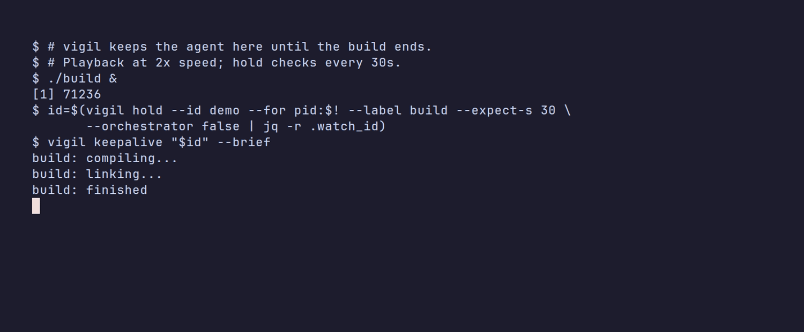

# vigil

vigil keeps a coding agent's turn open while it waits on builds, logs, commands, ports, processes and URLs, and tells the agent what changed when it wakes.

> Early release, 0.1.0. I use it every day with Claude Code and Codex on Linux. It has not been tried on macOS.



## Why it exists

Coding agents spend a lot of time waiting: for a build, a CI run, another agent, a usage limit to reset. The usual workaround is a background `sleep 270 && echo keepalive` that wakes the agent every few minutes so its session stays alive and its prompt cache stays warm. Every wake is a full model turn that learns nothing new. When one link in that chain breaks, the session goes quiet and the cache expires. In my own usage data, those ticks started turns that carried about a quarter of my estimated Claude spend ([measurements](https://github.com/mikenrafter/mstack/blob/main/research/06-usage-claude.md)).

vigil replaces the sleep with one tool, `keepalive`. The agent first says what to watch. Each `keepalive` call then blocks until something on the watch list happens or a time window ends, and returns what changed, how long it has been, and what to do next. A small model can judge changes a fixed rule cannot, such as "does this log show the build failed?". Between calls nothing watches: there is no daemon, and all state lives in files.

Each return is still a model turn. vigil has not been measured against the sleep loop. What it changes is that a turn comes early when something happens, and arrives with the evidence instead of a bare "keepalive".

## Terms

| Term | Meaning |
|---|---|
| watch | One job: inputs to read, how often, until when, and a rule for when to wake the agent. |
| tick | One round of reading a watch's inputs. Ticks run only inside a `keepalive` call. |
| keepalive | The call the agent repeats. It blocks for up to one window (270 seconds by default). |
| hold | A watch on the work itself: job ids, process ids, files that appear when work is done. It wakes the agent as each sensed piece ends. |
| judge | An optional HTTP endpoint that answers typed questions about the inputs (see [Judge](#judge)). |
| advisory | An operator rule delivered with vigil's wait results, such as "Boat hours are low; run builds locally". |
| reminder | A scheduled instruction delivered inside vigil calls when the agent works in a given directory. |

## Install

```sh
nix profile install github:mikenrafter/vigil      # with Nix
cargo install --git https://github.com/mikenrafter/vigil   # without Nix; needs Rust 1.89 or later
```

Connect it to your agent:

```sh
claude mcp add vigil -- vigil mcp                 # Claude Code
```

Claude Code moves any MCP call longer than two minutes to the background. Set `CLAUDE_CODE_MCP_AUTO_BACKGROUND_MS=280000` in the `env` block of its settings so a full `keepalive` window stays one call.

For Codex, in `~/.codex/config.toml`:

```toml
[mcp_servers.vigil]
command = "vigil"
args = ["mcp"]
tool_timeout_sec = 330   # Codex otherwise cuts the call before the window ends
```

## Use

From a shell, or by asking your agent to do the same through the MCP tools:

```sh
vigil create '{
  "prompt": "Wake me when the build finishes or fails.",
  "inputs": [{"kind": "file", "path": "/tmp/build.log", "tail_bytes": 4096},
             {"kind": "process", "pid": 41234, "want": "exited"}],
  "interval_s": 20, "deadline_s": 3600, "fire": "condition"
}'
vigil keepalive <watch_id>     # blocks; prints what changed and the next step
```

Inputs can be files, globs, commands, URLs, ports and processes. A watch fires on one of four rules:

| Rule | Fires when | Needs the judge |
|---|---|---|
| `change` | any input changes from its baseline | no |
| `condition` | every input with a `want` meets it | no |
| `hold` | every piece of work in the hold has ended | no |
| `judge` | the judge's answer matches `judge_rule` | yes |

To keep a session alive while other agents or jobs run:

```sh
vigil hold --for pid:41234 --label tests --expect-s 900
vigil keepalive <hold_id>
```

`file:PATH` ends when a completion file exists; `until:RFC3339` ends at a given time. A `none` item needs a label and ends when you call `vigil hold done <hold_id> <label>`.

The result's `next` field says what to do: `call keepalive again`, `act on events`, or `watch ended; create a new watch if still needed`. When the work is done, `vigil cold <id>...` cancels the named watches and tells the agent to write a short summary and stop. With no IDs, the CLI cancels nothing; the MCP `cold` tool defaults to the watches that server process created.

Agents need instructions to use this well. The [vigil skill](https://github.com/mikenrafter/mstack/blob/main/skills/vigil/SKILL.md) in mstack is the one I use.

## Judge

The judge is any HTTP endpoint that speaks a Jev-style typed-decision API: `POST /v1/predict` with a `state` string and a set of questions, each a yes/no (`noul`), a `choice` or a `score`, answered with probabilities and a confidence. Laya, a Python package, is one implementation. By default, vigil sends up to 2560 bytes of the prompt and changed inputs, with the newest lines first. Set `VIGIL_JUDGE_URL` (default `http://127.0.0.1:4010`). Without a reachable judge, watches with `fire: "judge"` are refused when you create them; every other rule works.

## Optional tools

vigil uses these only when they are installed. [docs/integrations.md](docs/integrations.md) shows how to set each up.

| Tool | What vigil does with it |
|---|---|
| [qex](https://github.com/stephenc/qex) | Hold items `qex:<job>` and `idle:<dir>` wait on queued jobs. |
| [usagewindow](https://github.com/mikenrafter/usagewindow) (`uw`) | On main-session calls, notices changes in Claude usage-credit state, ends the current wait with an event, and can run your hook. Without `uw`, vigil reads recent Claude Code session transcripts instead. |
| [Boat](https://boat.dev) | A first-use advisory counts remaining plan plus credit hours and warns at 10 hours or less. Seeded only if `boat` is on `PATH` and the advisories file does not exist. |
| T3 Code | Delegated runs with nothing to sense join a hold as `none` items and end with `vigil hold done`. |
| BabelTele | Set `VIGIL_COLD_SUMMARY` to change the summary `vigil cold` asks for. |

## Limits

- Nothing watches between calls. If the agent stops calling `keepalive`, nothing wakes it.
- It cannot start a session or resume a stopped one.
- Only Claude Code and Codex are tested.
- The judge is a small model and makes mistakes. Use `change` or `condition` when a fixed rule is enough.

## For agents and contributors

```sh
nix develop
cargo test        # spawns processes and binds loopback ports; not run in the Nix sandbox
```

The design and test rules are in [docs/spec.md](docs/spec.md) and [docs/specs/](docs/specs/). By default, state lives under `$XDG_STATE_HOME/vigil/`, falling back to `~/.local/state/vigil/`; advisories and reminders live under `$XDG_CONFIG_HOME/vigil/`, falling back to `~/.config/vigil/`. vigil keeps its own files outside repositories unless you override those paths.

## Credits

The file, URL, port and process inputs follow [mcp-await](https://github.com/ricardo-hdrn/mcp-await). Built with [rmcp](https://github.com/modelcontextprotocol/rust-sdk), the official Rust MCP SDK.

## License

MIT; see LICENSE.

Finished hold items append a JSON record to `$XDG_STATE_HOME/vigil/items.jsonl`
(default `~/.local/state/vigil/items.jsonl`). Records include the estimate,
start and end times, completion outcome, overdue flag, session when known, and
working directory. Use repeatable `--meta k=v` on `hold` or `hold add` for opaque
metadata such as `--meta model=opus --meta kind=review --meta brief=/work/brief.md
--meta items=3`; MCP `hold` and `hold_add` accept a `meta` object of string values.
Duplicate CLI keys keep the last value. Pass brief paths, never brief text or
secrets. Vigil reads no report or brief contents into the ledger. Each item
records its first end, including when a sensed job later retries; cancellation,
`cold`, and deadline release also record items still open. Ledger writes run
outside keepalive, make one append attempt, and log errors to stderr. This is
best-effort history: a crash, shutdown timeout, or failed state save can lose a
record; it is not a transactional audit log.
